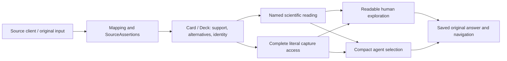

# Joining Sabueso development

This guide gives a new contributor the context needed to continue the project
without reconstructing months of chat or treating an old receipt as today's task.
It describes existing decisions and behavior; it does not authorize a new release
or change scientific policy. Read the [root instructions](../AGENTS.md) and
[MolI guide](../MOLI_GUIDE.md) as well.

## The purpose and the boundary

Sabueso is the Knowledge component of MOLI's Scientific Context. A researcher or
agent uses it to understand what sources say about a molecular system, inspect
support/conflicts/gaps and make an informed next decision. **Sabueso knows; it does
not discover.** It supports protein, small-molecule and MONDO-anchored disease
Cards. Peptide is a schema type with further scientific source/view work pending.

A Card contains one entity's retained knowledge; a Deck is a reproducible
collection with membership, exclusions and derivation context. Selection preserves
original SourceAssertions and alternatives. Named rules derive findings from
retained inputs; those findings are not new SourceAssertions. Nextia owns project
Evidence, Praxis owns methodological context and MolSysSuite owns molecular
modeling/calculation. Source declarations and calculated geometry can be connected
only through their explicit identity/reference/context contracts.

Read [VISION](VISION.md), [ARCHITECTURE](ARCHITECTURE.md),
[DATA_FLOW](DATA_FLOW.md) and [GLOSSARY](GLOSSARY.md) for the full vocabulary.

## The invariants to carry into every change

- Every value has its actual source support. Preserve conflicts, alternatives,
  original records, unknowns and missing-support reasons through every interface.
- Source-stated identity is required. Equal names, sequences, numbers or chemical
  values do not merge entities. Every identity or correspondence finding states
  its basis and scope.
- Unasked, failed, missing, explicitly empty and not applicable are different
  answers. An empty display filter cannot establish source-wide absence.
- Physical quantities preserve value, unit and meaning through PyUnitWizard.
  Units never live only in field names or disappear at a component boundary.
- Derived rules are named/versioned. Original schemas, frozen scientific kernels,
  producer controls and saved meanings remain reproducible; never regenerate old
  controls to make a new implementation pass.
- Source acquisition is explicit. Browsing a captured Card, opening support or
  reading a saved exploration cannot refresh sources, rebuild the Card or create
  knowledge. Source acquisition observations, bibliography, scientific support
  and source authenticity remain separate claims.
- Source-stated roles/mechanisms remain source knowledge. A derived concentration
  band alone does not establish inhibition, efficacy or mechanism. Measurement
  copies are not independent confirmations; unresolved context stays explicit.

## How the project reached this point

| Stage | Why it matters now / where to read more |
| --- | --- |
| Foundational design | Cards, SourceAssertions, relationships, selection, references and source adapters form the general model. [Original plans](archive/README.md#original-plans-superseded-still-tracked) remain tracked in ROADMAP |
| Pilot-driven development | Real MOLI projects pull useful work into that general model. They determine order, not the full scope. Private needs become generic contracts and public test systems; see [both roadmap routes](ROADMAP.md#how-the-two-routes-are-integrated) |
| Recovery of earlier local work | Useful material was reviewed and integrated with ownership/terms/tests; historical prototypes do not define a second architecture. [Recovery history](archive/local_work_2026-07/README.md) and deferred-provider triggers preserve what remains relevant without restoring the old stash |
| Published 0.14.0 | The last released artifact has its own source, frozen schema, installed gates, public install and archive receipt. It is distinct from the newer development tree; see [CHECKPOINT](CHECKPOINT.md) |
| Human and agent exploration design | Human access is intuitive and explanatory; agent access is compact, structured and economical while reaching the same retained knowledge. The [complete design inventory](pending_proposals/card_exploration_completion_0150.md) is required before 0.15.0 |
| 2026-11-04 audit | Correctness findings about bioactivity and measurement context took priority over more panels. The [audit](GLOBAL_AUDIT_20261104.md) is dated evidence; the [continuation plan](CONTINUATION_PLAN_20261104.md) owns the current response |
| Current continuation | Conservative activity interpretation has an earlier technically qualified checkpoint; B2 scientific/default review remains explicitly deferred. Structural journeys and independent chemical native/live/saved work advance the broad plan without closing human/scientific acceptance |
| Current machine move | Destination restoration and selected receiving are complete. The [handoff](WORKSTATION_HANDOFF_20261106.md) and original manifest preserve source-machine facts; the [destination review](evidence/destination_review_20261106.json) and [current checkpoint](CHECKPOINT.md) own the received state and remaining qualification |

Use [DECISIONS](DECISIONS.md) to trace a particular rule or issue, not as a required
sequential reading assignment. Current feature analyses link the original decision,
source controls and remaining acceptance. The [archived guide index](archive/README_before_onboarding_20261106.md)
retains the full former feature/receipt catalogue.

## Where code and information flow



| Change area | Main code / contract |
| --- | --- |
| Source acquisition | `sabueso/tools/db/`; [SOURCE_ACCESS](SOURCE_ACCESS.md) and source-specific client/fixture contracts |
| Translation and Card contribution | `sabueso/mappings/`, `sabueso/enrichers/`; declared enrichers, aggregation/resolution and the [source registry](sources/registry.yaml) |
| Native scientific reading | `sabueso/core/`; retained source inputs, named rules, quantities and exact support. Read the feature's current contract before changing policy |
| Human/agent navigation | `card_exploration*`, `card_access*` and topic adapters; one captured meaning with different presentation/delivery, not independent scientific inference |
| Independent saved reading | Versioned frozen kernels/verifiers and explicit format/representation dispatch. File-format numbers, semantic rule numbers, Card schema and packet mappings are different namespaces |
| Persistence and consumers | Snapshots, stores, migration and pinned packets; actual consumers own their scientific/operational receiving |
| Cross-cutting public behavior | ArgDigest, SMonitor, DepDigest, PyUnitWizard and runtime attribution; see the [contract index](README.md#contracts-and-conventions) |

## A first offline task

After verifying the development environment, run this from the checkout. It uses
a retained public control already present in Git, makes no provider request and
does not require a private pilot or credential. It demonstrates development
navigation, not a new scientific result or qualification of the saved candidate.

```python
import gzip
import json
from pathlib import Path

from sabueso.core.card import Card

control = json.loads(
    gzip.decompress(Path("tests/core/data/chemical_native_sdk192.json.gz").read_bytes())
)
card = Card.from_dict(control["cases"]["pga"]["card"])
before = card.to_dict()
explorer = card.explore()
print(explorer.overview())
print(explorer.questions())
selection = explorer.access.read(explorer.access.root_location)
page = selection.page(limit=3, max_bytes=4096)
print(page)
assert card.to_dict() == before
```

The human opening names delivered topics/questions. Agent delivery is bounded;
an atomic item that does not fit has an explicit reason/destination rather than
silent truncation. Discover actual topics before requesting a scientific answer.
Full stored content remains accessible through typed literal locations, including
values without a dedicated rich panel. See [PUBLIC_API](PUBLIC_API.md) and
[the user guide](../docs/content/user/card_exploration.md) for deeper examples.

## How to make a first change

1. Read [CHECKPOINT](CHECKPOINT.md#resume-here), the owning issue/current analysis
   and applicable code/test contracts. If resuming the existing workspace, verify
   its transferred state before fetching, installing or overwriting anything.
2. Work in Python 3.14 with participating local checkouts editable. Follow the
   [current workstation profile](TESTS.md#current-workstation-profile) and verify
   import/version paths inside and outside the checkout. The handoff preserves
   the suite-base and Sabueso-overlay bootstrap procedure for a new environment;
   completed receiving does not require repeating restoration. Dependency or
   profile adoption is not supplied by a historical environment receipt.
3. Use a bounded public input or clearly labelled synthetic counterexample.
   Change scientific meaning only through an explicit named policy/version and
   its original-data compatibility requirements. Keep a source statement distinct
   from your finding and from a project's interpretation of it.
4. Select checks by behavior in [TESTS](TESTS.md), run pytest through the receptor
   and read each gate's result. Keep source, installed, historical, workload,
   scientist and researcher acceptance separate. Respect CPU/RAM/swap budgets.
5. Update the relevant contracts and guide lines in the same change. Source/schema
   changes also follow registry, shape, migration and frozen-version rules. A docs
   fix does not need a new AGENTS instruction for every incident.
6. Commit only after applicable gates pass. Follow the authorized batching/CI
   route and inspect exact-source hosted gates through gh-run-receptor. A skipped
   run is not a pass. Publishing a release is a separate maintainer decision.
7. Report actionable findings under the owning issue and existing disclosure
   authority. Prepare concrete private/local material when permission is pending;
   do not route around it. Remove only owned disposable outputs after jobs finish.

## What we still need before 0.15.0

The [B0–B8 table](CONTINUATION_PLAN_20261104.md#execution-order) and
[broad inventory](pending_proposals/card_exploration_completion_0150.md) define the
full target. The corrected chemical reader now has a [705-case local checkpoint](evidence/chemical_saved_checkpoint_20261106.json).
That source-machine record remains unchanged. Destination environment/import
receiving and the corrected complete local offline checkpoint now pass:
[9,276 distinct cases at the `7ec81ce` baseline](evidence/destination_checkpoint_20261106.json), including
all 28 cases of the accepted finite MolSysMT journey. Nested copied-consumer and
repeated cases are not additional distinct coverage. The later
[Windows test-helper correction](evidence/windows_chemical_fixture_recovery_20261106.json)
has narrower receiving and leaves the library unchanged. The
[current action plan](CONTINUATION_PLAN_20261104.md#destination-review-and-next-actions)
continues with corrected-source hosted qualification, using the measured
destination resources. Complete local passing gates do not establish
a passing full hosted matrix.

After that checkpoint, B3–B6 and their scientific dependencies still include
remaining structural, activity/literature, molecule/clinical/disease and
variant/isoform/comparison/association journeys. B2 scientific/default adoption is
maintainer-owned and deferred. B7 requires actual scientist, uncoached researcher,
agent, representative workload, private-pilot and consumer acceptance.

The intended wow is observable: a researcher understands what is known, finds
what matters, sees why it is supported and knows how to continue, without learning
Card internals for routine work. More panels or green tests alone cannot prove
this. B8 and 0.15.0 publication remain paused until the agreed scope/acceptance
gates and explicit maintainer resumption.
