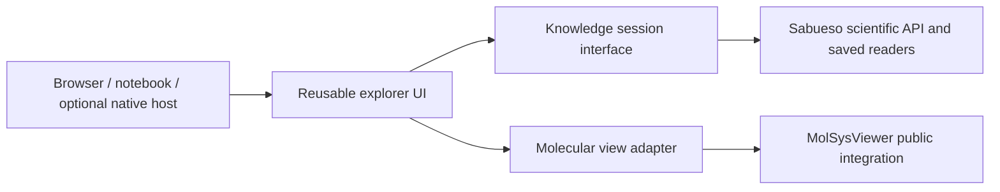

# Interactive exploration for 0.16.0

## Accepted objective and current decision

On 2026-11-12 the maintainer accepts a first complete, bounded visual exploration
experience as the product objective for **0.16.0**. Reuse the accepted functional
0.15.0 Card foundation and add coherent Card/Deck navigation, visible controls,
source inspection and molecular representation where applicable. A researcher
should orient, select, investigate and return without needing internal schema
knowledge for ordinary work.

MolSysViewer is the proposed molecular rendering provider, subject to the
platform discussion and bounded integration qualification. This objective does
not select a dependency minimum or installation route.

Owners: [#154](https://github.com/uibcdf/sabueso/issues/154) for presentation and
architecture selection, [#153](https://github.com/uibcdf/sabueso/issues/153) for
Deck exploration, and [#148](https://github.com/uibcdf/sabueso/issues/148) for
existing Card semantics and researcher feedback; #112 coordinates delivery.
This document records the maintainer decision and review locally. No new issue
comment or provider change is published by it.

The maintainer requests a review of MolSysViewer **before discussing and choosing
the platform and technology**. Hosting, frontend framework, public method names,
distribution and the complete release contract remain undecided. The next action
is that discussion, followed by a small architecture comparison prototype.

This advances a bounded part of long-term stage 6. Semantic queries, temporal
knowledge, real interoperability and scientific/source coverage retain their
roadmap owners and dependencies. They can supply a concrete need of this journey;
the entire six-stage program is not the scope of 0.16.0. The accepted 0.15.0
functional milestone and separate delivery/acceptance states are preserved.

## First product slice

- Provide a readable opening with entity, captured scope, useful knowledge,
  consequential gaps and a small set of scientific next actions.
- Support a first Deck overview, explicit membership basis, member selection,
  filtering/order and Deck → Card → scientific item → source → exact return.
  Keep different entity natures and repeated member revisions distinguishable.
- Provide visible search/filter/detail/source controls and navigation history.
  Retain current scientific readers and compact headless/agent access.
- Coordinate molecular selection with knowledge reading through MolSysViewer
  on explicitly supplied, mapped structural inputs. Cards without coordinates,
  including disease Cards, retain useful nonmolecular exploration.
- Preserve original values, units, support, unknown/conflicting scope and captured
  revisions across navigation and saved reopening. Acquisition remains explicit.
- Exercise a public protein → ligand → activity → assay/publication journey with
  return to its Deck, and one structural journey connecting a supported annotation
  and its original source to a molecular selection. Refine these proposed
  acceptance scenarios before coding.
- Use actual researcher feedback after 0.15.0 and measured representative session
  costs to assess understanding and fluency. Technical tests alone do not
  demonstrate the intended exceptional experience.

Video presentation (#155), a general document exporter, CLI, broad source
expansion and general scientific preparation/analysis retain separate scope.
Review #192's aggregation meaning/correction before the next release; its
0.15.0 deferral does not automatically apply to 0.16.0. Reconsider independent
researcher and platform exceptions under their existing owners as well.

## MolSysViewer review: source and method

Read-only review of the clean sibling checkout at
`0dcdd6ce574d3c99483480cb38c16c1e3cc4782f`, with live GitHub issue reads on
2026-11-12. No provider file, generated bundle, dependency or environment is
changed. No new rendering, browser/Qt observation, build, integration test or
installed-package qualification is claimed. Recorded provider capabilities and
test receipts describe their own source epochs.

The authoritative starting points are its
[architecture](https://github.com/uibcdf/molsysviewer/blob/0dcdd6ce574d3c99483480cb38c16c1e3cc4782f/devguide/architecture.md),
[capability audit](https://github.com/uibcdf/molsysviewer/blob/0dcdd6ce574d3c99483480cb38c16c1e3cc4782f/devguide/capability_audit.md),
[public API](https://github.com/uibcdf/molsysviewer/blob/0dcdd6ce574d3c99483480cb38c16c1e3cc4782f/docs/content/developer/public_api.md),
[Studio contract](https://github.com/uibcdf/molsysviewer/blob/0dcdd6ce574d3c99483480cb38c16c1e3cc4782f/devguide/studio_interaction_contract.md)
and [current handoff](https://github.com/uibcdf/molsysviewer/blob/0dcdd6ce574d3c99483480cb38c16c1e3cc4782f/devguide/checkpoints.md#resume-in-one-page).
The source manifests and implementation confirm these findings:

| Area | Observation | Consequence for Sabueso |
| --- | --- | --- |
| Molecular rendering | Mol* `PluginContext`, TypeScript and a prebuilt ESM bundle; JS declares `molstar ^5.4.1`, TypeScript and esbuild | Reuse MolSysViewer through its supported surface; avoid another Mol* scientific/selection adapter |
| Notebook transport | `MolSysViewerWidget` uses anywidget and traitlets; Python owns canonical scene/system state, with asynchronous identity-bound messages | Jupyter is a direct Python integration candidate. Anywidget is a transport/hosting boundary, not a frontend framework choice |
| Studio UI | Custom TypeScript/DOM panels, progressive disclosures, compact navigation, retained form drafts/focus and docked/floating panels/windows | Reuse interaction lessons. Internal panel classes/styles are not a supported general application toolkit |
| Molecular APIs | Public regions, representations, annotations, selection/focus and `on_click`/`off_click`; events expose loaded-system atom indices | Useful building blocks for a bidirectional binding prototype; source residue numbering requires an explicit mapping |
| Native shell | Optional PySide6/Qt WebEngine hosts the web runtime through `QtViewChannel`; the host remains experimental | A desktop shell can potentially share frontend work. Native dependencies and qualification need their own decision |
| Browser outputs | Interactive HTML export exists; static exports have no live Python authority. Local standalone and remote sessions have separate experimental/preview status | An HTML export does not establish a live general Sabueso application or a shared saved-Knowledge contract |
| Extension points | Add-on specifications and `AddonPanelWidget` host provider-owned tools/panels | A contextual Sabueso add-on is an option. Whole Deck/disease exploration also needs a useful entry without a loaded molecular scene |

Relevant implementation anchors are
[widget.py](https://github.com/uibcdf/molsysviewer/blob/0dcdd6ce574d3c99483480cb38c16c1e3cc4782f/molsysviewer/widget.py),
[interaction.py](https://github.com/uibcdf/molsysviewer/blob/0dcdd6ce574d3c99483480cb38c16c1e3cc4782f/molsysviewer/viewer/interaction.py),
[runtime entry](https://github.com/uibcdf/molsysviewer/blob/0dcdd6ce574d3c99483480cb38c16c1e3cc4782f/molsysviewer/js/src/index.ts),
[BasePanel](https://github.com/uibcdf/molsysviewer/blob/0dcdd6ce574d3c99483480cb38c16c1e3cc4782f/molsysviewer/js/src/ui/panels/base-panel.ts),
[QtViewChannel](https://github.com/uibcdf/molsysviewer/blob/0dcdd6ce574d3c99483480cb38c16c1e3cc4782f/molsysviewer/standalone_qt/view_channel.py)
and [add-ons](https://github.com/uibcdf/molsysviewer/blob/0dcdd6ce574d3c99483480cb38c16c1e3cc4782f/molsysviewer/addons.py).
Manifest declarations are not assertions about an installed dependency version.

The upstream [anywidget AFM specification](https://anywidget.dev/en/afm/) permits
plain or framework-generated ESM. Its current documentation describes newer
composition/lifecycle primitives than MolSysViewer's declared `anywidget>=0.9.15`
floor. A prototype must use the actually qualified API or justify its minimum;
it cannot assume every current documented feature exists at that floor.
[Qt WebEngine](https://doc.qt.io/qtforpython-6/PySide6/QtWebEngineWidgets/QWebEngineView.html)
provides a web-content host; choosing Qt does not remove the web frontend.

## Integration work and provider handoff

The reviewed source supplies visualization building blocks; it does not
establish a qualified Sabueso-to-MolSysViewer adapter. Define and qualify:

1. Exact captured Card/Deck and model identity, source revision, structural
   occurrence, chain, residue/atom mapping and model/frame context. Shared names
   or equal residue numbers never establish identity. Unmapped/ambiguous positions
   remain visible. MolSysViewer owns its loaded-source-to-Mol* permutation;
   Sabueso must not apply it a second time.
2. Bounded selection events in both directions, ownership of navigation versus
   camera/scene state, correlated completion and stale-result rejection.
   Closing/remounting the panel releases callbacks and molecular data.
3. Separate saved Knowledge reading and visual scene/session state, linked by
   exact inputs and qualified correspondences. A Viewer `.msv` session does not
   replace the original Sabueso exploration record.
4. An optional visualization dependency with useful headless access, explicit
   molecular-data loading and clear behavior without coordinates or live Python.
   A Card's source reference alone does not load a remote structure.

Owners: Sabueso #153/#154 for the consumer adapter; MolSysViewer for missing
public embedding/event capabilities; MolSysMT for molecular correspondence or
geometry it owns; MolI for a proposed shared Knowledge/visualization contract.
This is a local maintainer handoff of integration needs, not an observed provider
defect or accepted shared protocol. Prepare a concrete provider proposal when
the architecture/prototype identifies a missing API, reuse an existing owner
issue where appropriate, and publish only within scoped authority.

Provider follow-up already exists for notebook data retention
([#356](https://github.com/uibcdf/molsysviewer/issues/356)) and published Mol*
component-cache recovery ([#363](https://github.com/uibcdf/molsysviewer/issues/363)).
The reviewed build configuration applies a narrow local cache plugin. Qualify repeated
open/select/close on the exact integration version; those issues establish
neither a universal current leak nor final robustness. The local handoff's older
#344 open wording is superseded by its closed live issue state at this review.
Native Qt and remote previews retain the distinct limits in
[standalone surfaces](https://github.com/uibcdf/molsysviewer/blob/0dcdd6ce574d3c99483480cb38c16c1e3cc4782f/docs/content/developer/standalone_surfaces.md).

## Platform discussion and comparison

The review supports a web-technology frontend as a promising common direction;
the host and framework remain a maintainer decision. Compare candidates using
the same small public Card/Deck/structure tasks:

| Candidate | Main advantage | Work to establish before selection |
| --- | --- | --- |
| Jupyter first: Python + anywidget + TypeScript | Closest to current Sabueso use and MolSysViewer's supported notebook surface | Child-widget composition at actual supported versions, layout/lifecycle and usability with modest Python familiarity |
| Local browser application: Python backend + TypeScript frontend | Dedicated knowledge workspace without notebook navigation | Supported live Viewer embedding/transport, process/session lifecycle, local inputs and distribution; static HTML does not supply these |
| Qt shell around the web frontend | Native window/file integration already explored by MolSysViewer | Experimental host compatibility, event-loop/graphics and packaging qualification, compared with local browser hosting |

Product placement is separate: independent Sabueso explorer with an embedded
molecular view, or contextual Sabueso add-on inside MolSysViewer. The former
naturally accommodates Decks and entities without coordinates; the latter could
serve molecularly focused tasks. Compare entry experiences before making add-on
hosting the only route.

Plain TypeScript/DOM versus a UI framework is another independent choice. Neither
Mol* nor anywidget forces React, Svelte or Vue. Evaluate table/filter/detail
complexity, accessibility, reusable components and maintenance before choosing.
Shared patterns do not make Viewer internals a stable public dependency.

## Refined recommendation and portability requirement — 2026-11-12

The maintainer expresses a preference for an independent Sabueso application and
requires room to migrate to better infrastructure, with compatibility with
MolSysViewer and its future direction. **Infrastructure replaceability is a design
requirement.** The local-browser-first recommendation below, host/framework,
product name and shared interfaces remain proposals for discussion.

An independent application gives Cards, mixed Decks and entities without molecular
coordinates a complete home. It can preserve a full workspace, discoverable
actions, selection/history and source panels without a notebook's cell order or
kernel interaction becoming part of the researcher's ordinary task. Its costs
are real: session lifecycle, a frontend build, packaging, input handling and
application-level integration all become maintained product responsibilities.

The proposed first host is a **local browser application backed by Python**.
Provide a simple launcher, packaged frontend assets and a dedicated workspace;
ordinary retained-data browsing should work offline. Jupyter remains useful for
programmatic work and later embedding of the same components. A native window
can reuse the frontend when its value justifies its own qualification.

| Choice | Useful advantage | Cost or limitation for this product |
| --- | --- | --- |
| Notebook as the primary UI | Existing Python workflows and the most direct supported Viewer transport | Cells, kernel lifetime and notebook setup shape the user experience; a dedicated persistent Deck workspace needs extra design |
| Independent local browser application | Full workspace and a web frontend that can later serve other hosts; no notebook is needed for ordinary navigation | Python service/transport, local launcher, session recovery and live molecular embedding must be qualified |
| Native window immediately | Native file/window affordances and a clear desktop entry | Qt/Electron/Tauri each add runtime, packaging and graphics/platform receiving before the first product slice |
| Sabueso only as a Viewer add-on | Natural contextual knowledge alongside a loaded molecule | Deck/disease exploration and work without coordinates still need their own entry and scientific context |

### Boundaries that make a later migration practical

Keep the scientific core, knowledge-session operations, reusable UI and host
integration separate. The proposed dependency structure is:

- Scientific meaning, quantities, support and saved reading stay with Sabueso's
  existing Python APIs and versioned formats. GUI and HTTP models must preserve
  literal types and native quantity codecs; coercing values at a transport
  boundary must not silently change an original request.
- A small knowledge-session interface carries exact capture/selection references,
  bounded pages, operations and outcomes. Public Python and a web adapter use the
  same application operations. UI components consume that contract instead of
  parsing private Card storage or calling a particular server framework.
- A molecular adapter coordinates exact mapped selections and lifecycle with
  MolSysViewer. The provider owns its scene, picking, numerical buffers and
  rendering endpoints. Retain its control/data-plane separation rather than
  wrapping every molecular array in Sabueso JSON responses.
- Host-specific file dialogs, window controls, startup/shutdown and transport
  belong in host adapters. Components should not assume notebook globals,
  Qt objects, a fixed port, a workstation path or a particular rendering device.
- Persist scientific reading and lightweight workspace/view state separately,
  with explicit versions and exact references. A framework/widget object is not
  the archival representation. Future remote execution is a separate deployment
  decision, with explicit placement and infrastructure-owned resource control.

These boundaries reduce migration cost; changing framework, host or scientific
semantics still requires work and receiving. Implement only the small boundaries
needed by the first journey. Broader platform infrastructure is coordinated with
its owner rather than implemented independently inside this GUI.

### Compatibility with MolSysViewer's future plans

The additional review uses the same clean `0dcdd6ce` source and live #276.
Current contracts and dated owner decisions take precedence over older vision:

| Provider direction | Status and reference | Sabueso design implication |
| --- | --- | --- |
| One workbench and scene model across hosts | Maintained [standalone direction](https://github.com/uibcdf/molsysviewer/blob/0dcdd6ce574d3c99483480cb38c16c1e3cc4782f/devguide/standalone_direction.md) and [transport ownership](https://github.com/uibcdf/molsysviewer/blob/0dcdd6ce574d3c99483480cb38c16c1e3cc4782f/devguide/transport_state_ownership.md) | Consume provider projections/events through an adapter and preserve its authority; sharing a host does not require merging the two products' scientific state |
| Session on workstation/server/cluster; explicit client or server rendering | [Remote plan](https://github.com/uibcdf/molsysviewer/blob/0dcdd6ce574d3c99483480cb38c16c1e3cc4782f/devguide/remote_rendering_plan.md), retained unsupported preview outside the 1.0 contract | Keep knowledge endpoint and rendering placement separate; support capability negotiation before assuming a local WebGL canvas. Future remote or multiuser support is not delivered by local hosting |
| Binary transport now; possible windowed structural residency later | [Data plane](https://github.com/uibcdf/molsysviewer/blob/0dcdd6ce574d3c99483480cb38c16c1e3cc4782f/devguide/data_plane_architecture.md); [windowing #55](https://github.com/uibcdf/molsysviewer/blob/0dcdd6ce574d3c99483480cb38c16c1e3cc4782f/devguide/pending_proposals/post_1.0/structure_windowing_and_lazy_materialization.md) remains unimplemented design | Delegate structural transfer/materialization; avoid depending on private buffers or assuming all future frames are resident |
| Comparison viewports and synchronized cameras | [Multiview #49](https://github.com/uibcdf/molsysviewer/blob/0dcdd6ce574d3c99483480cb38c16c1e3cc4782f/devguide/pending_proposals/post_1.0/multiview_split_screen.md), post-1.0 design | Start with one bounded active molecular scene; let the provider own future viewport composition rather than creating a viewer for every Deck member |
| Evolved Qt versus Electron or Tauri | [#276](https://github.com/uibcdf/molsysviewer/issues/276) is open for post-1.0 evaluation; no host migration is approved | Preserve a portable frontend and a thin native adapter; compare exact workloads before selecting a shared host |
| Rust/WASM without a Python desktop backend | Separate long-term possibility in the [v2 vision](https://github.com/uibcdf/molsysviewer/blob/0dcdd6ce574d3c99483480cb38c16c1e3cc4782f/devguide/standalone_v2_evolution_plan.md), explicitly separated by #276 | Treat a future molecular engine or host change as a provider capability/version change. Sabueso's Python Knowledge backend has its own ownership and adoption decision |

Older installer-size, instant-start and host-superiority claims in the v2 vision
are hypotheses, as #276 explicitly records. They do not select Tauri/WASM or
establish future compatibility. Coordinate a public live-embedding contract with
MolSysViewer under #154 once the prototype identifies its exact needs; the
consumer proposal remains a local handoff pending scoped publication authority.

### Technology and first proof

TypeScript plus a component framework is a reasonable frontend candidate for
the growing selection/table/detail interactions. [Svelte](https://svelte.dev/docs/svelte/overview)
offers compiled declarative components; [React](https://react.dev/learn/add-react-to-an-existing-project)
can mount components within an existing application. Evaluate one bounded screen
against actual table/accessibility and Viewer mounting needs before adoption.
No frontend framework, minimum version or benchmark result is selected here.

For a Python web adapter, compare a thin FastAPI service (documented
[WebSockets](https://fastapi.tiangolo.com/advanced/websockets/) and
[lifespan](https://fastapi.tiangolo.com/advanced/events/) facilities) with the
aiohttp integration already used by Viewer. The session and scientific contract
must remain usable when that server adapter changes. A shared HTTP library alone
does not establish interoperability.

Native packaging stays a later independent choice. [Tauri](https://v2.tauri.app/concept/process-model/)
uses system WebViews and supports [external binaries](https://v2.tauri.app/develop/sidecar/),
including a packaged Python service. [Electron](https://www.electronjs.org/docs/latest/tutorial/process-model)
uses a Chromium-based process model. Qt has the existing experimental Viewer
bridge. Measure installer/runtime and WebGL behavior rather than promising
unmeasured startup or memory improvements.

The first prototype should prove one complete Card/Deck/source journey and one
exact molecular select/click/close round trip, with responsive bounded work and
save/reopen. A small second-host mounting check should exercise the boundary
without building another full application. These observations decide the initial
stack; remote/multiuser services and all native installers are separate increments.

### Product name proposal

Prefer **Sabueso** as the visible application name, with a descriptive subtitle
such as "Molecular knowledge explorer". "Sabueso Explorer" can distinguish the
graphical interface in documentation when needed. Product naming, internal
module/launcher names and whether optional GUI packaging warrants a separate
distribution remain separate decisions. No new brand, public command or package
name is selected by this naming recommendation.

## Execution after the platform discussion

1. Agree first host, product entry, framework comparison and bounded public tasks;
   record the decision under #154 before full implementation.
2. Specify the smallest Deck human/agent navigation contract under #153, reusing
   existing membership, explanations and captured Card readers.
3. Prototype the selected candidate(s), with one explicit molecular mapping and
   return/source continuity, to resolve the integration questions above.
4. Implement the chosen frontend and adapter incrementally, preserving ordinary
   Python/agent access, original saved meanings and optional visualization.
5. Obtain researcher feedback and measure representative latency/memory and
   repeated-open/close behavior; correct consequential failures and record the
   final supported 0.16.0 scope and limits.

The first discussion should settle notebook-first versus a dedicated local
application, the importance of an early native desktop window, and independent
explorer versus Viewer add-on placement. Dependency minima, provider receiving,
platform support and publication follow the evidence from that choice.
