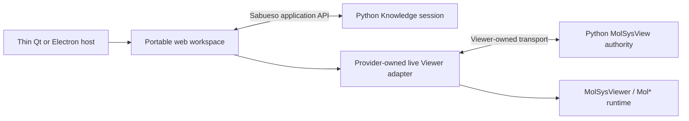

# Standalone infrastructure evaluation for 0.16.0

## Requirements and recommendation status

The maintainer confirms three constraints: a Python backend, embedded live
MolSysViewer representations, and a standalone user experience. Preserve the
[accepted experience](interactive_exploration_0160.md#researcher-controlled-assistant-experience--2026-11-12),
researcher-composable panels and replaceable infrastructure.

**Second critical review, 2026-11-12:** recommend a reusable TypeScript web
workspace, a separately owned Python session service and a provider-owned live
molecular adapter. Compare thin Qt/WebEngine and Electron hosts on the same real
journey before choosing the production host. The maintainer subsequently adds
Tauri as an equal current comparison candidate, not a later-only option.
Qt is the existing operational
baseline, not the default winner. React/TypeScript and Dockview's MIT core remain
the leading UI candidates; neither is required by MolSysViewer. These are
recommendations, not maintainer acceptance, dependency adoption or implemented
compatibility. The [development experiment](../../devtools/standalone_probe/README.md)
now implements this bounded workspace outside the installed Sabueso API. Its
[technical receipt](standalone_probe_20261113.md) separates measured/calibration
results, failed startup profiles and outstanding qualification.

Owner #154. Retain this evaluation through the first stack decision, then carry
accepted contracts and measured limits into the maintained implementation plan.

The earlier Qt-first recommendation over-weighted sharing a host with Viewer.
Its whole-window factory is not a ready embeddable Sabueso workspace, and its
runtime already admits different connectors. The React recommendation also
needs a narrower basis: application tooling and a maintained panel binding,
not a supposed requirement to match Mol*'s UI framework. Earlier browser-first
and Svelte suggestions likewise remain discussion history.

## What the second review establishes

| Observation | Consequence and limit |
| --- | --- |
| Python `MolSysView` accepts an injected transport; the remote client uses the same renderer behind a small model interface | The molecular core is not intrinsically Qt-only. Existing seams demonstrate a design possibility, not a supported external embedding API. |
| The Qt factory creates a complete app/window/page and keeps its live View through internal host wiring | Reusing it unchanged does not establish that Sabueso can compose arbitrary live molecular panels. Both finalist hosts still need an owner-approved integration surface. |
| Viewer creates a Mol* `PluginContext` directly | React is a Sabueso UI choice, not a molecular-engine requirement. Svelte or another standard web UI remains technically plausible. |
| Viewer owns explicit cleanup, scene/camera authority, binary transfer and endpoint identity | A consumer must retain that ownership instead of copying a bridge or implementing a second Mol* scene. |
| Panel libraries distinguish keeping hidden DOM alive from removing it; retained hidden panels can continue background work | Preserve the molecular lifetime deliberately and pause unnecessary work through a provider-supported capability. Layout appearance alone is insufficient. |
| Mol*'s published 5.x release and its v6 development tree differ substantially | Depend on the Viewer integration contract; keep engine upgrades with Viewer. Do not infer future compatibility from using the same JavaScript framework. |

Read-only review uses clean MolSysViewer
`0dcdd6ce574d3c99483480cb38c16c1e3cc4782f`. No local Mol* source checkout or
installed JavaScript dependency tree was present, so the engine review uses
versioned upstream source. No generated `viewer.js` or bundle was inspected.

## Distinct choices

The native window host, UI framework, panel manager, Python transport and
distribution route solve different problems. Qt can host the same web interface
as Electron; it does not require writing scientific panels as QWidgets. Qt
WebEngine itself separates rendering/JavaScript from the GUI process. Comparing
"single-process Qt" with "multi-process Electron" would be misleading.

| Host | Advantage for this use case | Work/cost still due | Proposed disposition |
| --- | --- | --- | --- |
| PySide6 + Qt WebEngine | Python-native application lifecycle and existing live Qt/Chromium experience in MolSysViewer | Native libraries, GUI event-loop/thread ownership, coherent Qt packaging and exact platform qualification; generic consumer embedding remains to qualify | Finalist; existing operational baseline |
| Electron + Python process | Chromium-based standalone web workspace with native-window APIs; desktop lifecycle fits a web-centered UI and avoids Qt-specific runtime dependencies | Maintain Node/Electron plus Python, process ownership and a new live connector; packaging and resource costs need measurement | Equal finalist; desktop-web product candidate |
| Tauri + Python sidecar | Native shell using system WebViews; can package an external Python service | Rust/shell layer and Python distribution, platform-specific WebViews, new adapter and WebGL/picking qualification | Equal current candidate, as requested by the maintainer; aligned with Viewer #276 |
| pywebview + Python | Small Python-facing host API and a JavaScript/Python bridge | Renderer/backend varies by platform; selecting Qt inherits its native dependencies; Viewer integration remains new | Secondary option without a demonstrated advantage over the direct Qt route |
| Local browser application | Reuses the frontend and keeps native host code small; useful for development and later remote adaptation | Browser/process lifetime, file integration and desktop presentation need deliberate design | Portability control and development host; dedicated window remains the product objective |

These are documented mechanisms and qualitative tradeoffs. The development probe
does not yet establish a comparable hardware benchmark, installer measurement or
native-platform receiving.
MolSysViewer/scene-data cost can dominate shell overhead; do not infer whole-app
memory or startup from a shell's advertised size.

Primary references: [Qt WebEngine 6.11 architecture](https://doc.qt.io/qt-6.11/qtwebengine-overview.html),
[Electron process model](https://www.electronjs.org/docs/latest/tutorial/process-model),
[Tauri WebViews](https://v2.tauri.app/reference/webview-versions/) and
[sidecars](https://v2.tauri.app/develop/sidecar/),
[pywebview architecture](https://pywebview.flowrl.com/guide/architecture) and
[renderers](https://pywebview.flowrl.com/guide/web_engine.html).
In particular, Tauri uses WebKit on Linux/macOS and WebView2 on Windows; an
existing Chromium observation does not establish those new renderer paths.

Electron's bundled Chromium makes the chosen renderer version reproducible,
but adds an update obligation: upstream supports only its three latest stable
major lines ([release policy](https://www.electronjs.org/docs/latest/tutorial/electron-timelines)).
Qt also needs browser-engine maintenance; its documented Chromium patching
policy is separate from the scientific Python dependency graph. Neither host
guarantees GPU correctness on every machine. Tauri can reduce bundled browser
payload, but Python and scientific data remain, and Linux introduces WebKitGTK
qualification. Advertised shell size is not a whole-application measurement.

## What MolSysViewer actually supplies

Pinned source observations:

- [Standalone surfaces](https://github.com/uibcdf/molsysviewer/blob/0dcdd6ce574d3c99483480cb38c16c1e3cc4782f/docs/content/developer/standalone_surfaces.md)
  distinguishes the persistent live Qt/Python host from static HTML export.
  Rendering an export is not a substitute for a live scientific session.
- [The factory](https://github.com/uibcdf/molsysviewer/blob/0dcdd6ce574d3c99483480cb38c16c1e3cc4782f/molsysviewer/standalone_qt/application.py)
  constructs a complete window and returns app/window/webview/path/title. It
  does not by itself qualify mounting a live molecular panel in an unrelated
  application workspace. Avoid treating reparenting its widgets or replacing its
  page as a supported embedding contract.
- [QtViewChannel](https://github.com/uibcdf/molsysviewer/blob/0dcdd6ce574d3c99483480cb38c16c1e3cc4782f/molsysviewer/standalone_qt/view_channel.py)
  connects a persistent Python View to live runtime messages. Provider-owned
  scene identity, binary payload transport, readiness and disposal must survive
  integration; importing internal helpers is not a durable consumer contract.
- [MolSysView](https://github.com/uibcdf/molsysviewer/blob/0dcdd6ce574d3c99483480cb38c16c1e3cc4782f/molsysviewer/viewer/core.py)
  accepts `transport=` with a widget-like send/receive/configuration surface.
  [The remote client](https://github.com/uibcdf/molsysviewer/blob/0dcdd6ce574d3c99483480cb38c16c1e3cc4782f/molsysviewer/js/src/remote/client-rendering-entrypoint.ts)
  adapts `get/on/off/send` to the same renderer. This is prototype/source evidence;
  remote support remains a post-1.0 preview, not a ready consumer dependency.
- [ViewerController](https://github.com/uibcdf/molsysviewer/blob/0dcdd6ce574d3c99483480cb38c16c1e3cc4782f/molsysviewer/js/src/managers/viewer-controller.ts)
  creates Mol* `PluginContext` and initializes its canvas without requiring the
  standard React PluginUI. [Runtime cleanup](https://github.com/uibcdf/molsysviewer/blob/0dcdd6ce574d3c99483480cb38c16c1e3cc4782f/molsysviewer/js/src/index.ts)
  eventually disposes the controller/plugin. A UI remount must not accidentally
  run this final-close path while the researcher is only moving a panel.
- [Supported-environment notes](https://github.com/uibcdf/molsysviewer/blob/0dcdd6ce574d3c99483480cb38c16c1e3cc4782f/devguide/standalone_supported_environment.md)
  record bounded Linux observations and pending native/installed scope. Qt is
  still experimental for Viewer 1.0. Sabueso gains no support claim from those
  observations. [#276](https://github.com/uibcdf/molsysviewer/issues/276) remains
  an open Qt/Electron/Tauri evaluation, not an approved migration.

Outside-checkout metadata in the shared Python 3.14 environment reports editable
MolSysViewer `0.24.0+409.g0dcdd6ce`, editable MolSysMT
`0.23.0+904.gff25f1202`, PySide6 6.11.2 and anywidget 0.11.0. FastAPI and
pywebview are absent. These are metadata observations only: no scientific import, GUI,
installer, graphics or cross-component execution is qualified by this review.

### Mol* changes reinforce the provider boundary

Viewer's lockfile consumes **Mol* 5.4.1**, distinct from its manifest range.
The latest published GitHub release read on 2026-11-12 is
[5.13.0](https://github.com/molstar/molstar/releases/tag/v5.13.0).
That difference alone is not a defect or permission to update the engine.

In [5.4.1 PluginContext](https://github.com/molstar/molstar/blob/v5.4.1/src/mol-plugin/context.ts),
mount/unmount and final disposal are different operations. The
[React canvas wrapper](https://github.com/molstar/molstar/blob/v5.4.1/src/mol-plugin-ui/viewport/canvas.tsx)
uses that lifecycle. Viewer currently initializes its own canvas/controller;
Sabueso cannot assume those upstream mount methods are its supported API.

The reviewed upstream development source
[`dabbf29`](https://github.com/molstar/molstar/blob/dabbf29f952880a034a9637e28c9844e3ae73d9f/README.md)
explicitly describes a **v6 prototype**, with separate library, plugin, UI,
headless, MVS and application packages. The
[Prism application manifest](https://github.com/molstar/molstar/blob/dabbf29f952880a034a9637e28c9844e3ae73d9f/apps/prism-viewer/package.json)
declares `6.0.0-dev.0`. These are future-direction observations, not a stable v6
release or an adoption recommendation. Engine/package/renderer changes belong
behind the provider adapter; using Mol* directly in Sabueso would create a
second upgrade and scientific-selection obligation.

## Workspace and frontend choice

[Dockview](https://dockview.dev/docs/overview/introduction/) documents docking,
tabs, floating groups, popout windows and layout serialization. React/TypeScript
is a reasonable leading candidate because it has a direct maintained binding
and suits a web application with many composed views. That does not demonstrate
superiority over Svelte's framework-neutral integration. Do not decide the
entire stack from the docking wrapper alone.

The current [feature/licence matrix](https://dockview.dev/docs/overview/licence/)
lists floating panels and layout save/restore in the free MIT core. Advanced
spatial keyboard navigation/docking and layout undo history are Enterprise
features. Evaluate actual accessibility needs and free-core APIs before adoption;
no commercial extension, trial or payment is authorized. Keeping a panel's
scientific context fixed is Sabueso behavior, separate from vendor "pinned tabs".

Use the panel manager for layout and lifecycle, not scientific state. Keep
original Card/read results in Sabueso, molecular/camera state with Viewer, and
workspace geometry in a versioned presentation record. Moving/docking a panel
must preserve or deliberately restore its rendering owner; do not reload the
whole page or recapture knowledge on every move. Browser popout support does not
automatically establish Qt/Electron native-window support.

The [panel rendering contract](https://dockview.dev/docs/core/panels/rendering/)
defaults to removing inactive content from the DOM; `renderer: 'always'` retains
it. Retention preserves DOM state but does not automatically stop animation,
timers or subscriptions. Versioned source at
[`37f246e`](https://github.com/dockview/dockview/blob/37f246e0525ea25eb9131f3c73acaf533785349d/packages/dockview-core/src/dockview/components/panel/content.ts)
and its [overlay owner](https://github.com/dockview/dockview/blob/37f246e0525ea25eb9131f3c73acaf533785349d/packages/dockview-core/src/overlay/overlayRenderContainer.ts)
confirms distinct attachment/visibility paths. The reviewed source manifest is
8.9.0; no package is installed or selected. Inspect the package-specific licence
when pinning the prototype; the [repository licence](https://github.com/dockview/dockview/blob/37f246e0525ea25eb9131f3c73acaf533785349d/LICENCE.md)
explicitly separates MIT packages from proprietary Enterprise.

For the first slice, use one web workspace with one molecular view and in-page
floating reading/graph panels. A floating HTML panel is not a new OS window or
an additional molecular scene. Introduce a second live molecular view only with
an explicit independent/shared-state requirement and measured resource cost.
Avoid one native WebView per card or panel. Electron itself discourages its
`<webview>` tag; [WebContentsView](https://www.electronjs.org/docs/latest/tutorial/web-embeds)
also requires native/DOM positioning coordination, unnecessary for ordinary
in-page composition.

Provide a useful default arrangement, direct topic access, keyboard-operated
open/close/move controls and a layout reset. Dragging and elaborate floating
layouts must remain optional. Qualify free-core accessibility and focus behavior
before choosing Dockview; if required accessible operations cannot be provided
maintainably, a simpler layout or another manager is preferable.

Golden Layout is another candidate, but its
[current guide](https://golden-layout.github.io/golden-layout/) advises building
from source because npm releases are old, and its
[popout contract](https://golden-layout.github.io/golden-layout/popouts/) leaves
cross-window state propagation to the consumer. Start by qualifying one panel
manager rather than building the same application around several libraries.

## Python transport and portability

Recommend a Python session service with an explicit lifetime, separately from
the UI/host lifecycle. Process separation permits containing a blocked/crashed
scientific operation and is possible with either finalist. It does not itself
provide cancellation, automatic recovery or resource limits: those require
deliberate implementation and receiving. Keep orchestration small; do not turn
0.16.0 into a distributed execution platform.

Knowledge and View authority may share the Python service; separate boxes show
ownership, not a requirement for multiple backend daemons. One UI framework and
three narrow boundaries suffice: Sabueso operations, Viewer integration and host
services. Do not build a generic plugin/transport framework for hypothetical
future migrations.

A mandatory HTTP server does not follow from the Python-backend constraint.
Compare one bounded transport through the finalist shells; local IPC or a local
HTTP/WebSocket service are options. FastAPI/aiohttp are implementation candidates,
not architecture requirements. Keep molecular binary data on the provider's data
plane rather than serializing every coordinate through a generic JSON RPC.

Keep small versioned commands/results, capture/selection references and native
quantity codecs independent of Qt, React and a server framework. Long-running
operations must not block the UI; qualify their bounded scheduling and supported
cancellation with the scientific/connector owners. Future infrastructure controls
execution placement and resources. Native dialogs/window actions and molecular
transport each retain an adapter with an explicit lifetime.

This preserves a practical route to Electron, Tauri, browser/Jupyter hosting or
future provider rendering changes. A migration still requires work and exact
receiving; shared web technology alone guarantees no future compatibility.

Keep original saved Knowledge, Viewer scene state and presentation layout as
separate, referenced records. Dockview JSON must not become the authoritative
session format; use an application-owned versioned layout description or a
bounded vendor payload with an explicit fallback/migration policy. Preserve
typed identities, original revisions/support and quantities at the Python/UI
boundary. Never create a Card/structure identity mapping from a matching name,
index or residue number.

### Distribution is a separate decision

A standalone experience, a launcher using a managed Python environment and a
self-contained installer are different delivery milestones. Qt has
[Python deployment tools](https://doc.qt.io/qtforpython-6/deployment/index.html);
Electron/Tauri can launch a separately packaged Python runtime. None removes
Sabueso/MolSysMT's native scientific dependency closure or proves a clean install.
Compare an identical pinned scientific environment for the first experiment;
receive an independent clean distribution separately before promising an
installation route. Do not combine optional Qt and Electron runtimes into the
same shipping artifact merely to preserve the comparison.

MolSysViewer [#276](https://github.com/uibcdf/molsysviewer/issues/276) already
keeps Qt/Electron/Tauri evaluation open. Its older host/v2 documents contain
explicitly superseded Numba arguments and unmeasured size/startup/UI assertions;
they do not mandate a Sabueso migration or a Python-free application. Its
[remote plan](https://github.com/uibcdf/molsysviewer/blob/0dcdd6ce574d3c99483480cb38c16c1e3cc4782f/devguide/remote_rendering_plan.md)
preserves one authority and explicit client/server rendering placement, but
remains a preview. Support that future boundary without implementing remote
rendering or adopting unstable protocol details in 0.16.0.

## Proposed provider handoff

Consumer need under #154: **a supported live embedding surface for external
standalone Python applications**. This is an improvement request, not a newly
reproduced rendering bug. Desired owner review:

- Mount a molecular runtime within a host-supplied workspace/container while
  retaining one Python View authority and its declared model/source context.
- Expose readiness, selection/click events, resize, scene continuity and disposal
  through a small public integration surface, preserving binary transfer.
- Distinguish hide/show, in-page move, temporary detachment and final close.
  Declare whether background rendering/animation can be suspended and resumed
  without losing camera, selection or pending scene ownership.
- Specify what survives in-page docking and what requires a distinct endpoint
  for a separate native window. Keep unpublished/private protocol details owned
  by Viewer rather than copied into Sabueso.
- Receive one public molecular model with the real runtime, exact bidirectional
  selection, repeated resize/move/open/close and a surviving independent view.

Exact API and whether to extend an existing host belong to MolSysViewer. The
public embedding surface and its visibility/lifetime semantics are the actionable
provider proposal. Offer the owning issue, cross-link #154/#276 and avoid
duplicating #276's existing host comparison. This section is a reviewable local
maintainer handoff, not an external publication or a reproduced provider bug.
A shared MolI contract, if needed, requires its own owner review.

## Bounded decision experiment

1. Review the provider-owned embedding contract and define one portable UI
   slice. Use a public frozen Card/Deck and an explicitly mapped public molecular
   model. Keep the same Python cohort, Viewer revision, frontend build, input
   bytes and viewport policy across the two shells. Record unavoidable browser
   engine differences. Browser hosting is a portability control, not a third
   product implementation.
2. Run thin Qt and Electron connectors sequentially. Exercise topic selection,
   exact bidirectional molecular picking/source navigation, a floating reading
   panel, resize/dock, hide/show and context following/keeping. A mocked canvas
   or static export cannot qualify live integration. Check an original saved
   session reopening without silently acquiring current knowledge.
3. Begin with one live molecular view. Repeat a declared finite move/hide/close
   cycle (proposed: twenty repetitions); verify camera/selection continuity,
   no unintended reload, predictable focus and released callbacks/processes.
   Check that hiding a view does not leave unnecessary active rendering and
   that closing one view preserves an independent survivor. Capability gaps
   remain explicit if suspension/recovery is unsupported.
4. Measure cold/warm window-to-usable-Card and first-drawn-model times,
   interaction response, total owned process-tree memory, hidden/idle CPU,
   GPU/rendering backend and closeout. GPU allocations and host-wide RAM are
   not interchangeable with process RSS. Compare startup/installed/download
   sizes only at equal scientific/runtime scope. Record the initial packaging
   work and likely maintenance, including upgrades and binary transport copies.
5. Preflight shared CPU/RAM/swap/pressure and scheduler availability before
   graphical/bundling work. Use low concurrency and an owned-process limit;
   measure a small model before increasing size. Do not consume all available
   cores or assume a resource check reserves the machine. Keep visible native,
   headless/software, Linux, Windows and installed results separate; macOS is
   outside the current Sabueso support scope.
6. Both finalists must preserve scientific identity, live selection, saved
   context, UI responsiveness and cleanup. Prefer the one with lower demonstrated
   integration/maintenance cost for Linux and Windows at acceptable measured
   resources. Retain Qt if its public integration and packaging reuse actually
   reduce that cost; choose Electron if its desktop-web lifecycle gives a
   material benefit after Python/process/update costs are included. If both
   are blocked by the same Viewer capability, fix/report that shared need
   instead of treating another shell as its solution. Tauri enters only for a
   measured unmet distribution/resource requirement. Record the decision and
   reassessment trigger, then implement one product host.

The experiment has no accepted numerical performance budget yet. Agree it from
the representative workload and measured baseline; do not transplant the B7
save/reopen budget or score frameworks using invented performance numbers.

No provider change, dependency install, runtime prototype, benchmark, paid
service, release or platform-support expansion is performed by this document.
